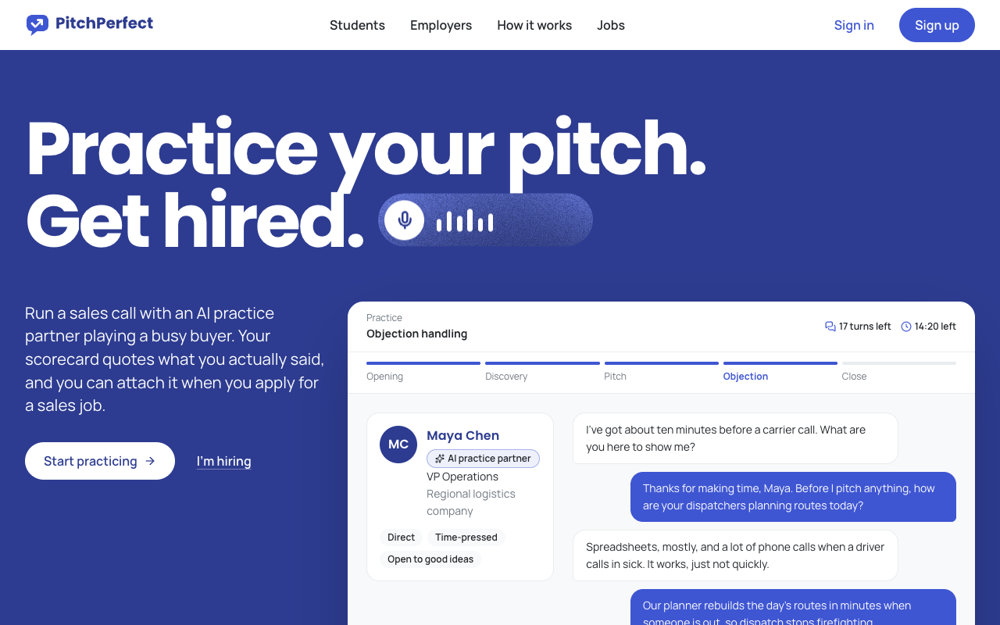
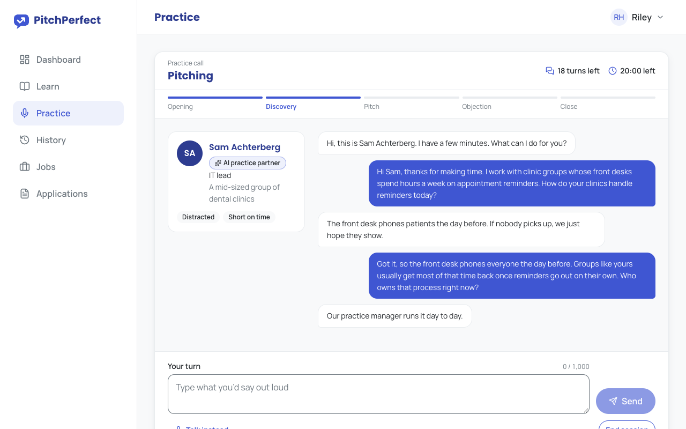
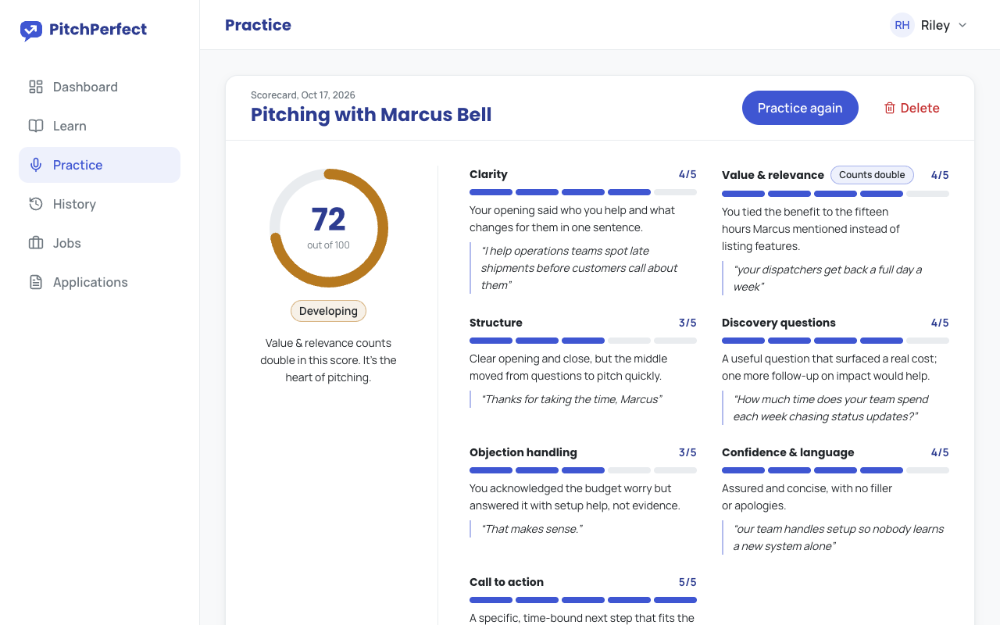
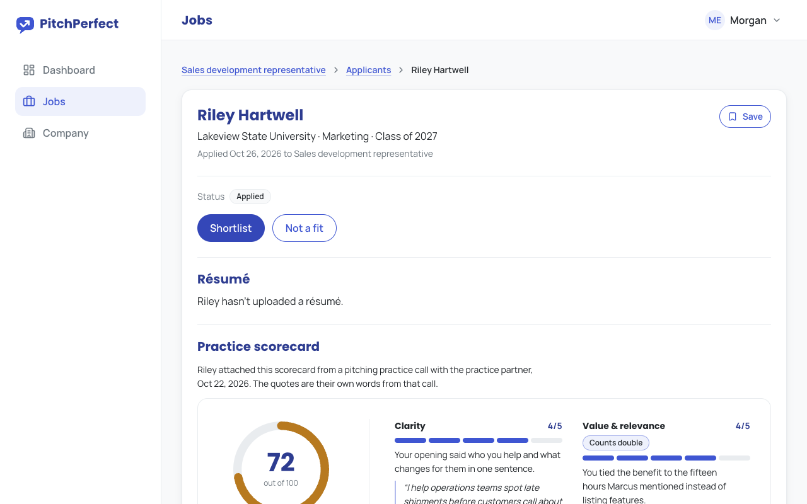

# PitchPerfect

Practice the sales call out loud before the real one, then apply with the scorecard.

PitchPerfect is a practice and hiring site for entry-level sales jobs. A student reads a short lesson on one skill, then runs the call by voice or text with a practice partner that plays the buyer: a live model from OpenAI or Anthropic when a key is set, or a scripted partner when it isn't. When the call ends they get a scorecard that quotes what they actually said. Employers post roles and, if a candidate chooses to share one, read that scorecard next to the application.

> Status: portfolio project. It runs end to end on your machine with seeded demo data; deployment steps are in [docs/deploy.md](docs/deploy.md).
>
> **Live demo:** https://shashank11yadav.github.io/PitchPerfect/ is a static build on GitHub Pages. You can run a practice call with the scripted partner (it and the scorer run in your browser, since Pages can't run a live model), read the lessons and browse the job board; accounts, applying and the employer tools need the api and database, so they are only in the full app.

## What's inside

| Area          | What it does                                                                                                                                                                                             |
| ------------- | -------------------------------------------------------------------------------------------------------------------------------------------------------------------------------------------------------- |
| **Learn**     | Eight short lessons, one per core skill: introducing yourself, pitching, objection handling, probing and discovery, referrals and networking, next steps, asking for the business, interpersonal skills. |
| **Practice**  | Pick a skill (or a real job posting), pitch by voice or text to a buyer persona with hidden objections, then get a 7-dimension scorecard with strengths, improvements, and a rewritten stronger line.    |
| **Jobs**      | Public job board. Students save, apply, optionally share a scorecard, and track status.                                                                                                                  |
| **Employers** | Company profile, job posting with a safe rich-text editor, applicant pipeline (shortlist, interview, hire, not a fit), interview scheduling, dashboard.                                                  |

## Screenshots

Taken with `npx tsx e2e/screenshots.ts` from the containers (`docker compose --profile full up --build -d`) with the demo data and the default practice limits. No key is set there, so the partner is the scripted one and the practice room labels it "Scripted demo partner"; with a live model the badge reads "AI practice partner". The call on the home page is a sample, labelled "Sample buyer".









## Architecture at a glance

```
Browser ──► apps/web (Next.js, port 3000)
              │  /api/* is proxied (same origin, first-party cookies)
              ▼
            apps/api (Express + MongoDB, port 4000)
              │  HMAC-signed internal calls only
              ▼
            apps/coach (practice partner service, port 4100, never public)
              │
              ▼
            LLM provider (OpenAI or Anthropic, chosen by env)
```

- `apps/web`: Next.js App Router site: public pages (server-rendered per request for SEO), student app, employer app.
- `apps/api`: REST API: accounts, sessions, companies, jobs, applications, lessons, and the practice proxy.
- `apps/coach`: the independent practice partner service: HMAC-checked routes over `packages/partner`, its config, the OpenAI and Anthropic adapters, and the evals.
- `packages/partner`: the practice partner engine (prompts, guardrails, the provider interface, and the plan, turn and score steps), used by coach and by the static demo in the browser.
- `packages/scripted-partner`: the scripted provider, which runs the engine without a model or keys, for local dev, tests, e2e and the static demo.
- `packages/shared`: zod schemas, types, constants, the fictional seed data, and small helpers (slugify, UTC calendar days, PII redaction) shared by all apps.

Details: [docs/architecture.md](docs/architecture.md).

## Quick start

Requirements: Node 22.12 or later (`.nvmrc` pins 22) and Docker.

```bash
git clone https://github.com/shashank11yadav/PitchPerfect.git pitchperfect && cd pitchperfect
npm install
cp apps/api/.env.example apps/api/.env
cp apps/coach/.env.example apps/coach/.env
cp apps/web/.env.example apps/web/.env.local
npm run dev:infra      # MongoDB + Mailpit (local email inbox) in Docker
SEED_DEMO_PASSWORD='pick-a-12-plus-char-password' npm run seed -- --demo   # companies, jobs, two demo accounts
npm run dev            # web, api, and coach with hot reload
```

The demo student (`student@pitchperfect.example`) and employer (`employer@pitchperfect.example`) both sign in with the `SEED_DEMO_PASSWORD` you set; it needs 12 or more characters and is never printed. You can put it in `apps/api/.env` instead of the command line. With `--demo` the employer account also gets its own company (Lanecrest Freight Visibility) with two open jobs, and the student has one application to it. Without `--demo` the seed loads only the six fictional companies, their jobs, and their employers.

Open http://localhost:3000. Verification and password-reset emails land in Mailpit at http://localhost:8025.

The practice partner runs with `COACH_PROVIDER=fake` by default, a deterministic offline persona, so everything works without an API key. To use a real model, set `COACH_PROVIDER=openai` or `anthropic` plus the matching key and model IDs in `apps/coach/.env`. Every sentence of a real model's reply is moderated before it is shown: by the OpenAI moderation endpoint when `OPENAI_API_KEY` is set, otherwise by a classifier call through `COACH_MODEL` (`COACH_MODERATOR`, see [docs/deploy.md](docs/deploy.md#environment-variables)).

To run the whole stack in containers instead, use `docker compose --profile full up --build -d`. It needs no `.env` files: it runs on `dev-only-` placeholder secrets and the `fake` partner (unless `apps/coach/.env` picks a provider), and serves http://localhost:3000 (set `WEB_PORT` if 3000 is taken). Load the demo data into it with:

```bash
docker compose exec -e SEED_DEMO_PASSWORD='pick-a-12-plus-char-password' api node dist/scripts/seed.js --demo
```

## Scripts

| Command                                                    | What it does                                                                                                                                                                                |
| ---------------------------------------------------------- | ------------------------------------------------------------------------------------------------------------------------------------------------------------------------------------------- |
| `npm run dev`                                              | Run web, api, and coach in watch mode                                                                                                                                                       |
| `npm run dev:infra`                                        | Start MongoDB and Mailpit containers                                                                                                                                                        |
| `npm run seed -- --demo`                                   | Load demo data and accounts (idempotent; needs `SEED_DEMO_PASSWORD`)                                                                                                                        |
| `npm run purge`                                            | Delete expired attempts and tokens, abandon stale sessions, clear unfinished starts, delete résumé copies past the employer's window                                                        |
| `npm run build`                                            | Build every workspace                                                                                                                                                                       |
| `npm run lint` / `npm run format` / `npm run format:check` | ESLint / Prettier (write) / Prettier (check only, as CI runs it)                                                                                                                            |
| `npm run typecheck`                                        | TypeScript project-wide check                                                                                                                                                               |
| `npm test`                                                 | Unit and integration tests for all workspaces                                                                                                                                               |
| `npm run e2e`                                              | Build, then Playwright end-to-end tests on a throwaway database (needs `dev:infra`; fake provider). Ports 3000, 4000 and 4100 move with `E2E_WEB_PORT`, `E2E_API_PORT` and `E2E_COACH_PORT` |
| `npm run e2e:smoke`                                        | Read-only smoke test of a running site: `BASE_URL=https://… npm run e2e:smoke`                                                                                                              |
| `npm run build:pages -w apps/web`                          | Build the static GitHub Pages demo into `apps/web/out` (docs/deploy.md)                                                                                                                     |
| `npm run e2e:pages`                                        | Build the static demo, serve it under `/PitchPerfect/` on port 3100 (`E2E_PAGES_PORT`) and run its Playwright checks                                                                        |
| `npm run lighthouse`                                       | Lighthouse CI on `/`, `/students` and `/jobs` against `next start` (needs a build and the api)                                                                                              |
| `npm run check:dead`                                       | knip (unused files, exports, deps) and jscpd (duplication)                                                                                                                                  |
| `npm run eval -w apps/coach`                               | Run practice partner evals against a real provider (needs a key)                                                                                                                            |
| `npm run admin -- <command>`                               | Admin CLI: `migrate`, `list-unverified`, `approve-company`, `suspend-company`, `unsuspend-company`                                                                                          |
| `npm run admin:prod -w apps/api -- <command>`              | The admin CLI run from the compiled build, for production. `seed:prod` and `purge:prod` work the same way                                                                                   |
| `npx tsx e2e/screenshots.ts`                               | Retake the screenshots above from a running stack with the demo data (needs `SEED_DEMO_PASSWORD`; `BASE_URL` defaults to http://localhost:3000)                                             |

## Documentation

| Doc                                                            | Read it when you're...                                         |
| -------------------------------------------------------------- | -------------------------------------------------------------- |
| [docs/architecture.md](docs/architecture.md)                   | Getting oriented: services, data model, request flows          |
| [docs/conventions.md](docs/conventions.md)                     | Writing any code: structure, naming, validation, errors, tests |
| [docs/api.md](docs/api.md)                                     | Adding or calling an endpoint                                  |
| [docs/practice-partner.md](docs/practice-partner.md)           | Working on personas, scoring, guardrails, or providers         |
| [docs/design-system.md](docs/design-system.md)                 | Building UI: brand tokens, components, accessibility, SEO      |
| [docs/security.md](docs/security.md)                           | Touching auth, data, uploads, or anything user-facing          |
| [docs/deploy.md](docs/deploy.md)                               | Deploying                                                      |
| [docs/limits.md](docs/limits.md)                               | Wondering what's intentionally out of scope                    |
| [docs/design/product-design.md](docs/design/product-design.md) | Understanding why the product is shaped this way               |
| [CONTRIBUTING.md](CONTRIBUTING.md)                             | Opening a pull request                                         |

## Security

Never commit secrets. Every app reads configuration from its own `.env` (see the `.env.example` files). CI runs gitleaks and `npm audit`. To report a vulnerability, see [docs/security.md](docs/security.md#reporting).

## Author

Built by Shashank Yadav. Website: [shashankyadav.dev](https://www.shashankyadav.dev/) · GitHub: [@shashank11yadav](https://github.com/shashank11yadav)

## License

[MIT](LICENSE). Third-party code keeps its own license; see [THIRD_PARTY_NOTICES.md](THIRD_PARTY_NOTICES.md).
